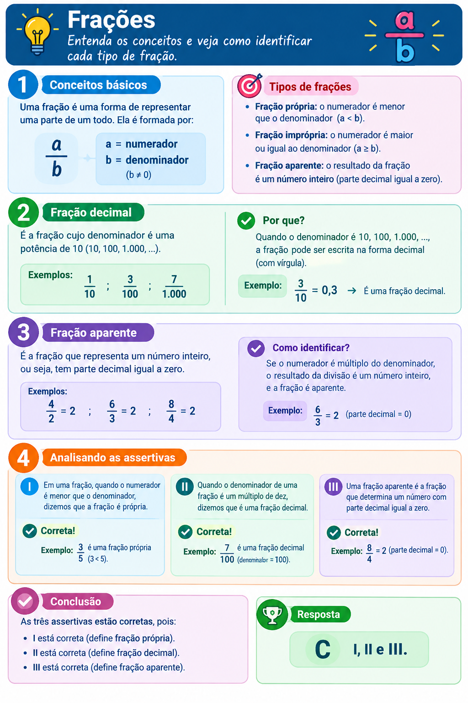

# Frações e Números Decimais

## Conteúdo

- [Questões](#questions)
- **Resumos passivos:**
<!---
[WHITESPACE RULES]
- Same topic = "10" Whitespace character.
- Different topic = "200" Whitespace character.
--->

<!--- ( Questões ) --->

---

## Questões

**TÍTULO:** Q4262444 | Ano: 2026 Banca: CPCON Órgão: UEPB Prova: CPCON - 2026 - UEPB - Auxiliar de Laboratório de Fotografia  
**LINK:** https://www.qconcursos.com/questoes-de-concursos/questoes/7fbc6c00-a2  
**TÓPICO:** Aritmética e Problemas , Frações e Números Decimais
**STATUS:** 0/1

RESPOSTA

 

  

 
 

---

**Rodrigo** **L**eite da **S**ilva - **rodrigols89**
