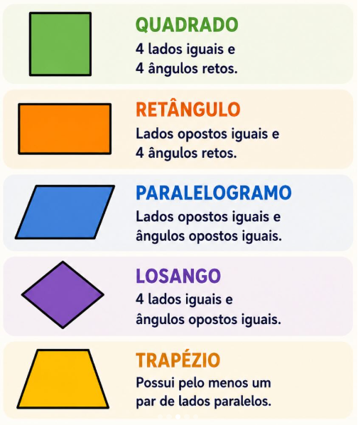

# Quadriláteros

> Um quadrilátero é qualquer `polígono plano` que possui **quatro lados**, **quatro vértices** e **quatro ângulos internos**.

## Conteúdo

- [Questões](#questions)
- **Resumos passivos:**
<!---
[WHITESPACE RULES]
- Same topic = "10" Whitespace character.
- Different topic = "200" Whitespace character.
--->

<!--- ( Questões ) --->

---

## Questões

**TÍTULO:**Ano: 2026 Banca: CPCON Órgão: UEPB Prova: CPCON - 2026 - UEPB - Auxiliar de Laboratório de Fotografia  
**LINK:**https://www.qconcursos.com/questoes-de-concursos/questoes/7fc3dc87-a2  
**TÓPICO:** Aritmética e Problemas , Geometria Plana , Quadriláteros , Razão e Proporção; e Números Proporcionais ( assuntos)
**STATUS:** 0/1

DICAS

 

- PM + Pm = 100
- O perímetro do maior é igual a quatro vezes o perímetro do menor:
- PM = 4.Pm

RESPOSTA

 

Comentário de **"Gabriel Bassetto"**.

 
 

---

**Rodrigo** **L**eite da **S**ilva - **rodrigols89**
